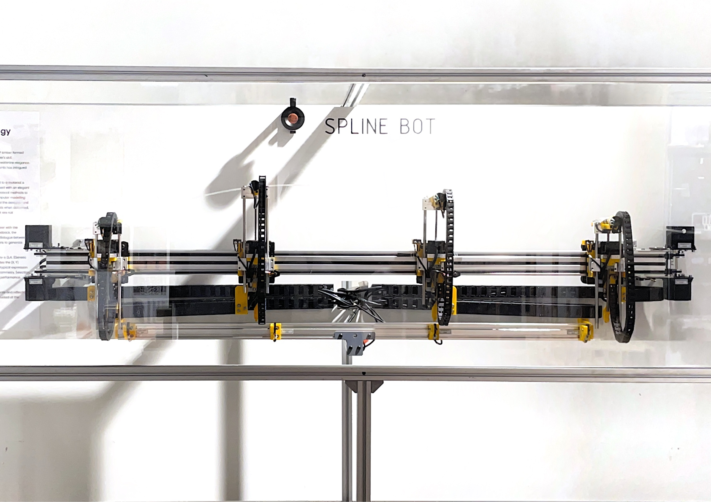
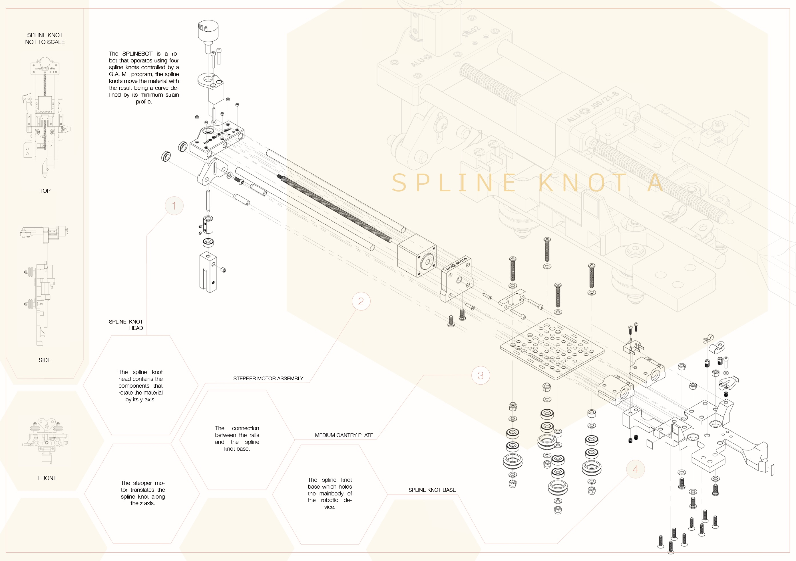
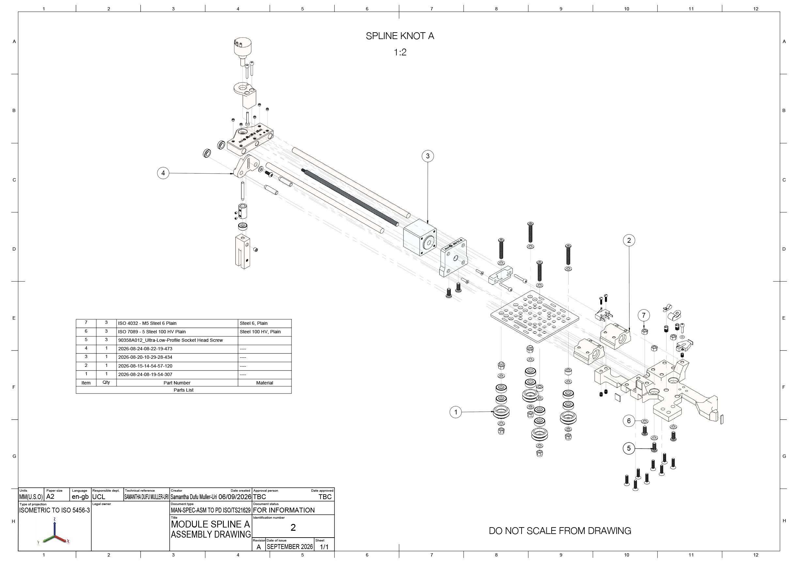
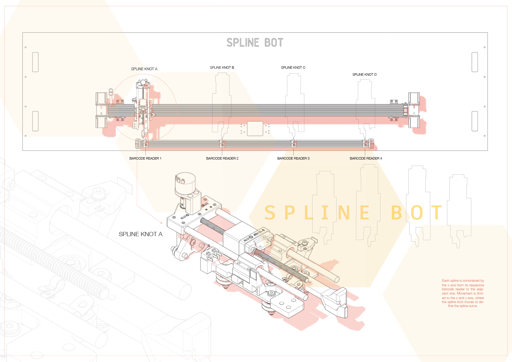
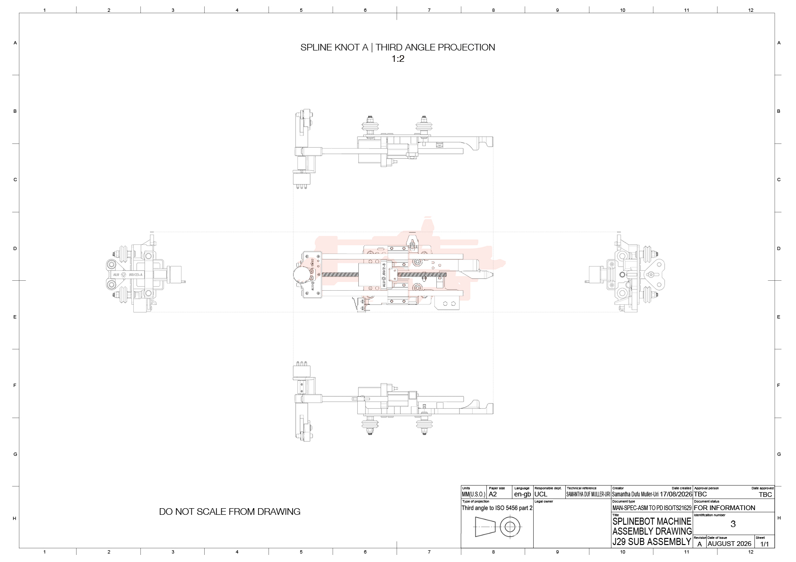
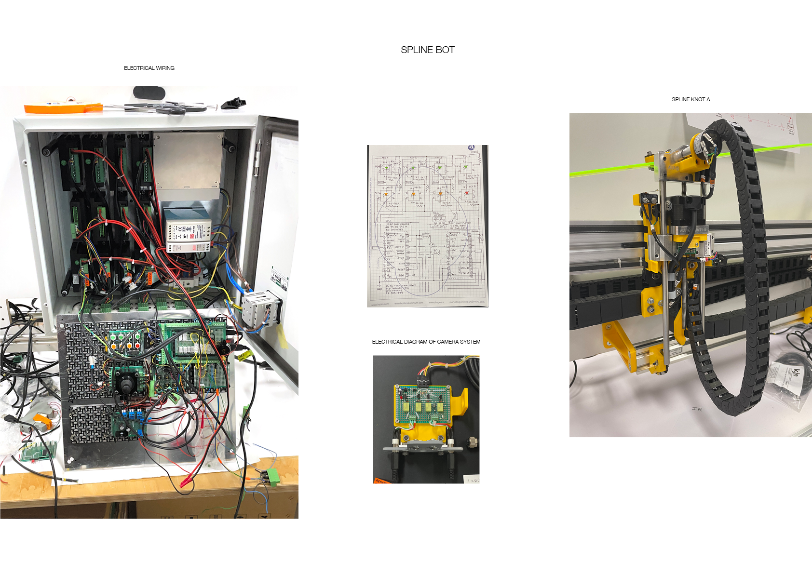
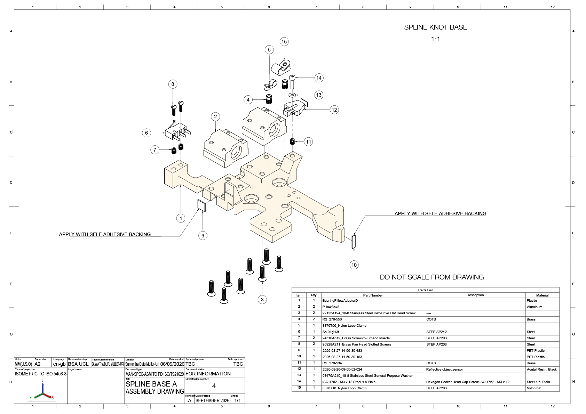
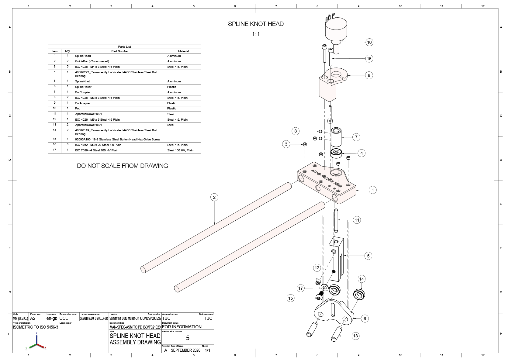

# Spline_Robot
I developed and put together the components of the spline robot with Prof. Christopher Leung after making a mass assembly of one of the predominant mechanisms (featuring 4 main subassemblies), the 'spline knot' itself. The 4 spline knots can manipulate the position of a piece of material and discover its shape as it deforms under its least strain energy 

"The “SplineBot” operates four CNC spline-knots controlled by an G.A. (Genetic Algorithm) machine learning program. The genotype encodes the (X, Y) coordinates of the four knots (A, B, C and D) with the phenotypical expression the resultant minimum strain profile digitised using photogrammetry. Selection criteria applied to populations of profiles include structural performance, ventilation airflow and manufacturing etc."

